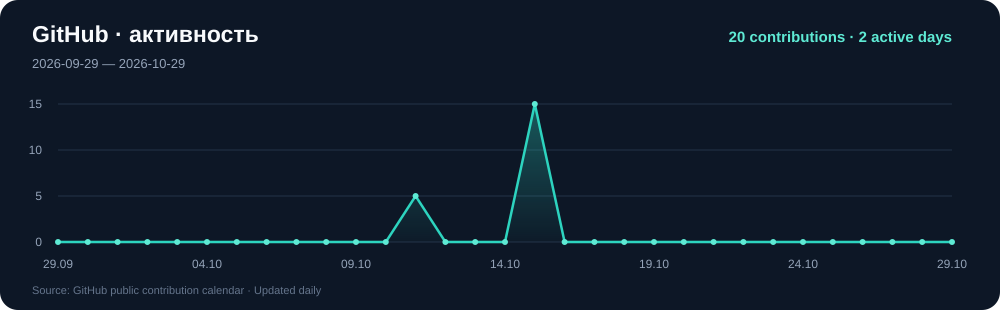

  

  <a href="https://t.me/andr3ikaG"><b>Telegram</b></a> ·
  <a href="mailto:mrmaderator42@gmail.com"><b>Email</b></a> ·
  <a href="https://www.kaggle.com/mrmoderator"><b>Kaggle</b></a> ·
  <a href="https://vk.com/agol0vanov"><b>VK</b></a>

Разрабатываю ML-проекты на Python: от исследования данных и обучения модели до приложения, которое можно запустить и проверить. Работаю с табличными данными и текстами, разбираю ошибки моделей и делаю результаты понятными через визуализации и веб-интерфейсы.

**Направление:** Data Science / ML Engineering.

---

## 🚀 Проекты

<table>
  <tr>
    <td width="36%" align="center">
      
    </td>
    <td>
      <h3><a href="https://github.com/golovanov-andrei/MoscowPrices">🏙️ MoscowPrices</a></h3>
      
Оценка стоимости квартир в Москве по характеристикам квартиры и расположению.

      
CatBoost, Flask-сайт и API, форма предсказания, интерактивная карта метро. В README — запуск и условия оценки качества.

      
<b>Python · CatBoost · Flask · Folium · JavaScript</b>

    </td>
  </tr>
  <tr>
    <td align="center">
      
    </td>
    <td>
      <h3><a href="https://github.com/golovanov-andrei/Reviews">📝 Reviews</a></h3>
      
Классификация тональности англоязычных отзывов и исследование тем обсуждений.

      
TF-IDF с униграммами и биграммами, Logistic Regression, анализ ошибок и пять тем LDA с визуализацией pyLDAvis.

      
<b>Python · scikit-learn · NLP · LDA · pyLDAvis</b>

    </td>
  </tr>
  <tr>
    <td align="center">
      
    </td>
    <td>
      <h3><a href="https://github.com/golovanov-andrei/Credit-risk">💳 Credit-risk</a></h3>
      
Учебный скоринг: единый Pipeline для обучения, CLI и приложения Streamlit.

      
Train / validation / test, выбор порога по F1, сравнение с baseline и объяснение вкладов признаков. Целевая метка задаётся искусственным правилом.

      
<b>Python · scikit-learn · Streamlit · pytest · GitHub Actions</b>

    </td>
  </tr>
</table>

Дополнительно: [Spring_2026 — учебные работы](https://github.com/golovanov-andrei/Spring_2026).

---

## 🛠 Стек

| Направление | Инструменты |
| --- | --- |
| Данные | Python, pandas, NumPy, SQL |
| Machine Learning | scikit-learn, CatBoost, Logistic Regression, Pipeline |
| NLP | TF-IDF, CountVectorizer, LDA |
| Визуализация | Matplotlib, Seaborn, Folium, pyLDAvis |
| Приложения | Flask, Streamlit, HTML, CSS, JavaScript |
| Разработка | Git, GitHub Actions, pytest, Jupyter Notebook, Google Colab |

---

## 🔎 На что обращаю внимание

- **Качество эксперимента:** разбиение данных, метрики, baseline и ограничения оценки.
- **Воспроизводимость:** понятный запуск, сохранение предобработки вместе с моделью.
- **Рабочий результат:** интерфейс, обработка входных данных и проверки критичных сценариев.

---

## 📈 Активность

Публичные contributions GitHub за последние 31 день. График обновляется ежедневно.

